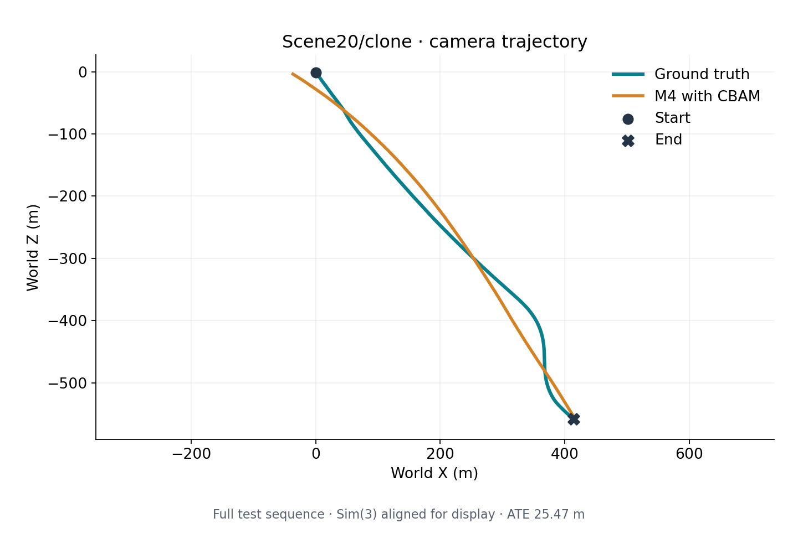

# Deep Monocular Visual Odometry

[](https://github.com/VaibhavBansal05/Deep_Monocular_VO/actions/workflows/ci.yml)

Estimating camera motion from a single moving camera, using four approaches on
[Virtual KITTI 2](https://europe.naverlabs.com/research/computer-vision/proxy-virtual-worlds-vkitti-2/).
Team deep learning project · Manipal Institute of Technology · 2026

We compared a classical-feature regressor (M1), a recurrent CNN (M2), a
self-supervised depth-and-pose network (M3), and an attention-based CNN (M4).
Each predicts six-degree-of-freedom relative camera motion; the same held-out
`Scene20/clone` sequence was used for the pose results below.

## Results at a glance

| Model | Approach | Sim(3) trajectory error ↓ | SE(3) trajectory error ↓ |
| --- | --- | ---: | ---: |
| M1 | ORB features + multilayer perceptron | 24.21 m | 68.32 m |
| M2 | ResNet18 + LSTM | 61.65 m | 82.84 m |
| M3 | Self-supervised depth + pose | 25.08 m | 227.12 m |
| **M4** | **ResNet18 + CBAM attention** | **25.47 m** | **75.27 m** |

These are absolute trajectory error (ATE) root-mean-square values from the
saved [test results](src/results/). Sim(3) aligns the estimated path to ground
truth **including scale**; SE(3) fits a rigid transform **without changing
scale**. M3's large scale-fixed error is consistent with the unresolved metric
scale of RGB-only self-supervision and its accumulated drift. These are results
on one held-out scene, not claims of general performance across datasets.



*Full test trajectory in world X–Z coordinates. The M4 path is Sim(3)-aligned
for display; alignment uses the reference trajectory and does not resolve
monocular scale at inference. The figure can be regenerated with
[`plot_readme_trajectory.py`](src/scripts/plot_readme_trajectory.py).*

## My contribution: M4 and its attention test

I developed the [M4 pose model](src/mvo/models/m4_cnn_attention/) around a
pretrained ResNet18 encoder. It takes two consecutive RGB images, applies
Convolutional Block Attention Module (CBAM) after each encoder stage, and regresses
the camera's relative translation and rotation. I also built the initial
repository scaffold and shared training contracts, worked on supervised pose
training fixes, and ran and checked M4's 60-epoch Kaggle experiments. Other
team members owned the dataset loader, geometry and metrics, and M1–M3; their
work is recorded in the [contribution log](src/reports/CONTRIBUTIONS.md).

To isolate the effect of attention, I compared CBAM with the **same M4 model
without attention**, using the same data split, code revision, seed, training
budget and checkpoint-selection rule:

| M4 test metric ↓ | CBAM | No attention |
| --- | ---: | ---: |
| Sim(3) ATE | **25.47 m** | 26.89 m |
| SE(3) ATE | 75.27 m | **53.39 m** |
| Relative translation error | 35.67% | **33.66%** |

CBAM improved scale-aligned ATE on the test scene and the mean Sim(3) ATE over
four held-out weather/camera conditions (79.76 m versus 102.13 m). Without
attention, scale-fixed ATE and local translation error were better. The effect
was **mixed**, and one seed is insufficient to claim attention is always
better. See the [full attention comparison](src/results/m4/ATTENTION_COMPARISON.md)
and its [run provenance](src/results/m4/README.md).

## Project structure

| Path | What it contains |
| --- | --- |
| [`src/mvo/models/`](src/mvo/models/) | Four model implementations |
| [`src/mvo/common/`](src/mvo/common/) | Shared data, geometry, training and metrics |
| [`src/configs/`](src/configs/) | Versioned experiment configurations |
| [`src/results/`](src/results/) | Metrics, trajectories and experiment notes |
| [`src/scripts/`](src/scripts/) | Training, evaluation and comparison commands |

The [synopsis](DOCS/MVO_Synopsis.pdf) describes the original research plan;
[PLAN.md](PLAN.md) and the [final report](src/reports/final/) provide more
context. Model ownership: [Pranav](src/mvo/models/m1_classical_mlp/) (M1),
[Abhishek](src/mvo/models/m2_cnn_rnn/) (M2),
[Suryansh](src/mvo/models/m3_selfsup_posedepth/) (M3), and
[Vaibhav](src/mvo/models/m4_cnn_attention/) (M4).

## Reproduce locally

```bash
git clone https://github.com/VaibhavBansal05/Deep_Monocular_VO.git
cd Deep_Monocular_VO
python3 -m venv .venv
source .venv/bin/activate
pip install -e 'src[dev]'
cd src
pytest -q
# Download/extract the VKITTI2 subset under src/data/vkitti2 first.
python scripts/train.py --model m4 --config configs/m4.yaml \
  --data-root data/vkitti2 --out checkpoints/m4
python scripts/eval.py --model m4 --ckpt checkpoints/m4/best.pt \
  --data-root data/vkitti2 --split test --out results/m4_local
```

GPU experiments used [Kaggle notebooks](src/notebooks/) and the public
[VKITTI2 RGB subset](https://www.kaggle.com/datasets/vaibhavkrishnabansal/vkitti2-subset).
Checkpoints and raw data are excluded from Git; small result files are kept
under [`src/results/`](src/results/).

## Repository rules

1. **`mvo/common/` is shared.** Changing it needs a PR reviewed by the whole team,
   because it changes everyone's results. Your model lives in `mvo/models/mX_*/`
   and nobody else touches it.
2. **The pose convention is frozen**: 6-vector `[tx,ty,tz,rx,ry,rz]`, translation
   first, axis-angle rotation, meaning `T_{t->t+1}`. Defined in
   `mvo/common/train/base_model.py`.
3. **The split is frozen**: `mvo/common/data/splits.py` is the only place scenes are
   listed. Changing it invalidates every result in `results/`.
4. **Merge with `--no-ff`, never squash.** Squash-merge collapses individual commits
   and destroys the per-member history that is being graded. Squash merging is
   disabled in repo settings.
5. **Never commit** data, checkpoints or `.npy` caches. Small artefacts
   (`results/*/metrics.json`, trajectory `.txt`, plots) *are* committed.
6. **Any borrowed code goes in `mvo/common/`** with an attribution header and an
   entry in [THIRD_PARTY.md](THIRD_PARTY.md).

## Evaluation protocol

- **Split** (by scene, no geometric leakage): train `Scene01/06/18` × {clone, morning,
  overcast, sunset} · val `Scene02/clone` · test `Scene20/clone`.
  `rain / fog / 15-deg / 30-deg` are held out entirely for the robustness ablation.
- **Metrics**: ATE RMSE (reported both `sim3`, scale-solved, and `se3`, scale-fixed),
  RPE translation/rotation at δ=1, KITTI `t_rel` / `r_rel`, plus depth AbsRel/RMSE/δ<1.25
  for M3. Params (M) and ms/frame for the compute trade-off.
- **Scale**: M1/M2/M4 train with metric pose labels; RGB-only M3 has unresolved
  depth/translation scale. Depth median scaling applies only to depth scores,
  never to the pose trajectory. Report both scale-aligned `ate_sim3` and
  scale-fixed `ate_se3` explicitly.
